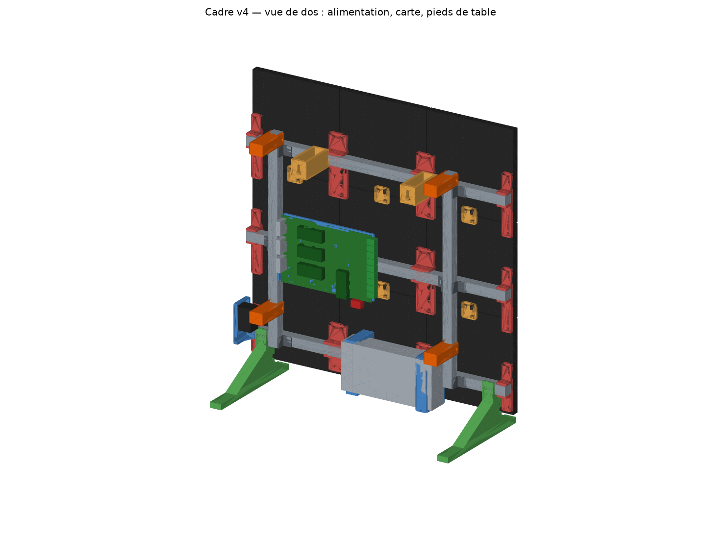
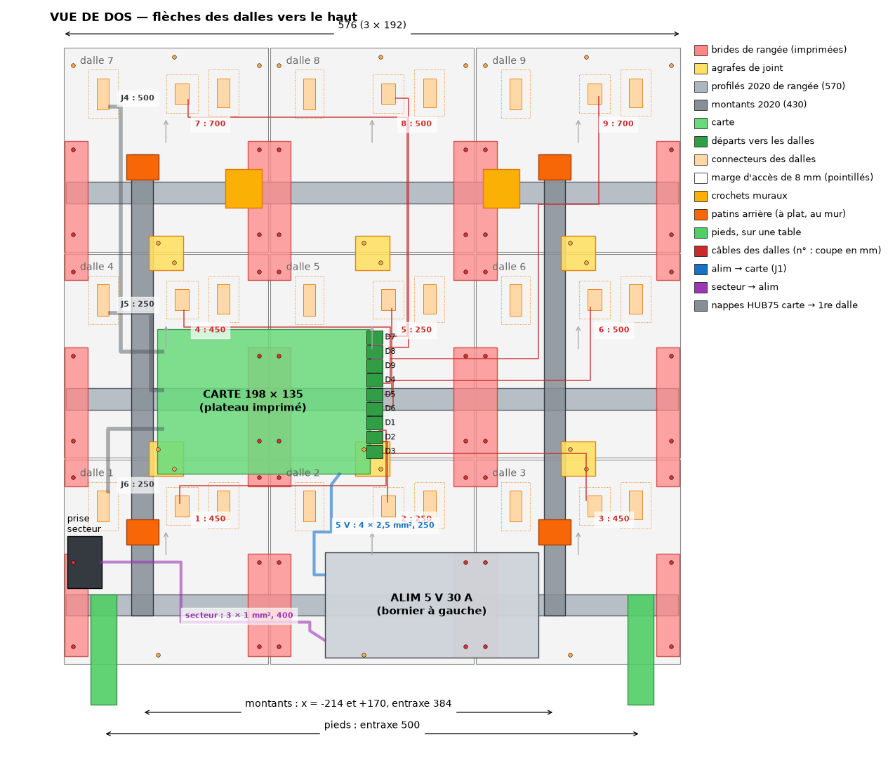
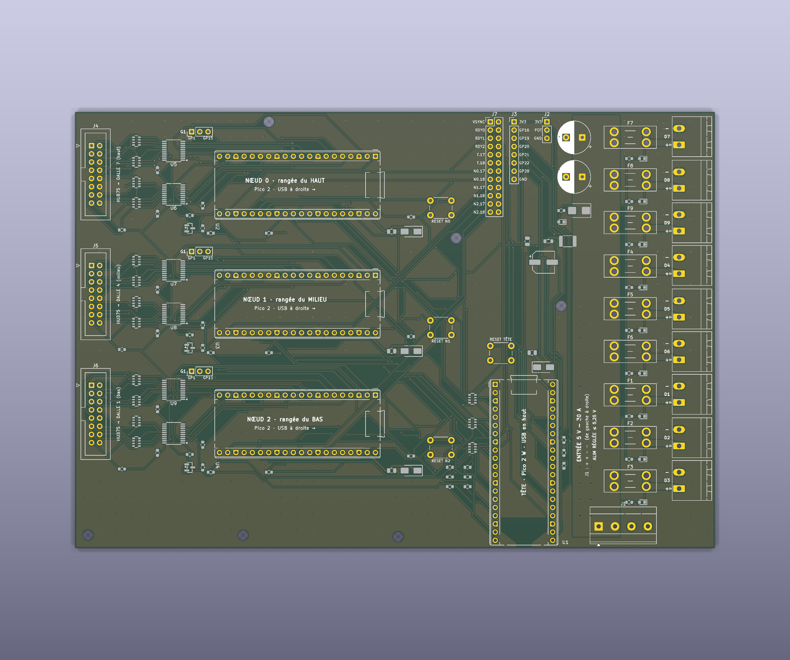
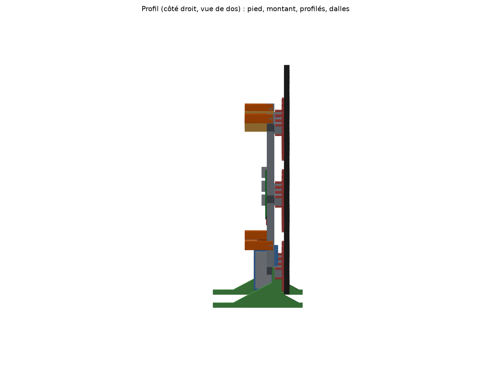
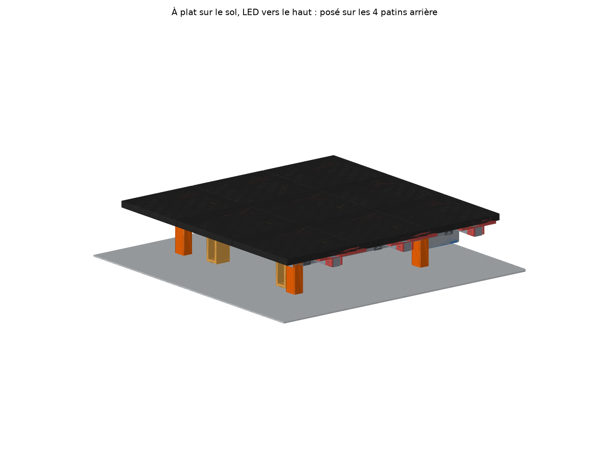
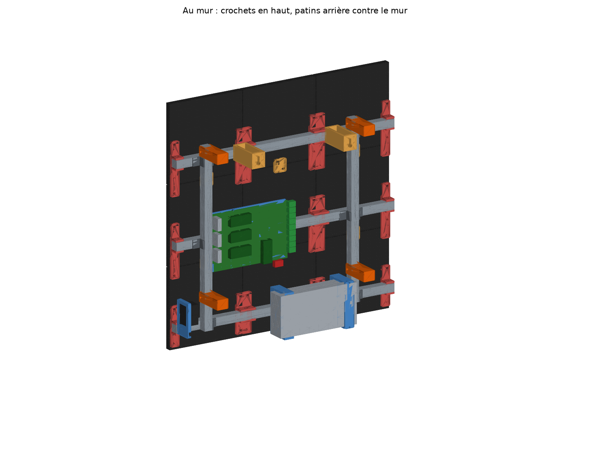

# Matériel de l'écran 3 × 3 — le montage définitif

*Conçu le 29/10/2026.* L'écran fonctionne ; son montage de preuve de concept a fait son
office. Ce dossier le remplace par un montage qu'on peut poser à plat sur le sol, mettre
debout sur une table, accrocher au mur, et dépanner sans démonter : **une carte** où s'enfichent les quatre Pico et toutes les
nappes, **un cadre** en profilés aluminium 2020 et pièces imprimées, **un faisceau**
d'alimentation propre, du secteur à chaque dalle.

**État : conçu et vérifié par calcul ; cartes reçues de JLCPCB le 05/11/2026, à monter.** La
carte passe les contrôles électriques de KiCad sans une erreur ; le cadre passe ses contrôles
d'interférences et d'accès. Ce qui reste à vérifier sur pièce est listé au [§8](#8-limites-et-points-à-vérifier).
Le montage de la carte, étape par étape et éprouvé à chaque étape :
[`montage-carte.md`](montage-carte.md).

**Ce qu'il faut acheter : [`liste-materiel.md`](liste-materiel.md)**, de l'ordre de 250 à
350 €, hors dalles, Pico et alimentation, déjà là.



---

## 1. Ce qui change

| Sur le montage de preuve de concept | Dans le montage définitif |
|---|---|
| Les dalles s'affaissent : des plaques de PLA les tiennent entre elles, et le PLA flue sous le poids | Chaque rangée est vissée sur un **profilé aluminium 2020**, et les trois profilés sur **deux montants 2020**. L'aluminium porte, le plastique ne fait plus que relier |
| Des fils volants au dos | **Une carte** : les 4 Pico sur supports, les liaisons tête → nœuds en pistes, les tampons de niveaux, les 3 embases HUB75, les 9 départs d'alimentation |
| Plusieurs cosses écrasées ensemble sur chaque borne de l'alimentation | **Un câble par dalle**, protégé par **son fusible** et débrochable à la carte ; de l'alimentation à la carte, **quatre fils de 2,5 mm², un par borne** |
| Les Pico alimentés par USB | Les Pico **tirent leur 5 V du même bus**, à travers un fusible réarmable, une ferrite et une diode Schottky par Pico. L'USB reste branchable pour flasher : aucun des deux n'alimente l'autre |
| Ni pied ni accroche | **Quatre patins arrière**, toujours en place : l'écran se pose **à plat sur le sol**, LED vers le haut, ou s'accroche au mur par **deux crochets** à trou de serrure. **Deux pieds** amovibles le tiennent debout sur une table, droit ou penché de 10° |
| Les connecteurs des dalles difficiles à atteindre | **Rien** — cadre, carte, alimentation, câbles — au-dessus d'un connecteur de dalle ni à moins de 8 mm, jusqu'au plan du mur. Le générateur du cadre le vérifie à chaque exécution |

Le firmware ne change pas d'une ligne : la carte reprend les brochages des `config.h` de
la tête et des nœuds.

---

## 2. Vue d'ensemble

Vue de dos, flèches des dalles vers le haut, numérotation du cadre v3 :

```
   7 8 9   ← nœud 0 (U2), nappe J4 → entrée de la dalle 7      crochets muraux sur ce profilé
   4 5 6   ← nœud 1 (U3), nappe J5 → dalle 4   ┐ la carte, sur les dalles 4 et 5
   1 2 3   ← nœud 2 (U4), nappe J6 → dalle 1   ┘ l'alimentation, sur le profilé du bas
           4 patins arrière au bout des montants ; pieds de table sous le profilé du bas ;
           prise secteur à gauche
```



| | |
|---|---|
| Encombrement | 576 × 576 mm ; 120 mm de la face des LED au sol, ou au mur |
| À plat sur le sol | sur les 4 patins arrière, rectangle d'appui de 384 × 340 mm ; centre de gravité à 131 mm de son bord |
| Debout, sur une table | écran à 25 mm de la table ; patins des pieds de 240 mm, qui dépassent de 35 mm devant |
| Masse | environ 7,5 kg, estimée pièce par pièce : dalles ≈ 4,5 kg, alimentation ≈ 0,7 kg, cadre et carte ≈ 2,3 kg |
| Alimentation | une seule, **5 V 30 A**, sur le profilé du bas ; secteur par une embase IEC à interrupteur et fusible |

---

## 3. La carte — [`carte/`](carte/)



**198 × 135 mm, 2 couches, cuivre 2 oz.** Elle se visse sur un plateau imprimé, lui-même
vissé au profilé de la rangée du milieu, une patte appuyée contre le montant gauche.

| Repère | Rôle |
|---|---|
| **J1** | entrée 5 V 30 A, bornier à vis : bornes 1-2 = +5 V, 3-4 = masse. Deux fils de 2,5 mm² par polarité |
| **F1–F9, J11–J19** | les 9 départs, un par dalle : fusible lame mini **7,5 A** et fiche débrochable au pas de 5,08 mm. Repérés D1 à D9 sur la sérigraphie |
| LED11–LED19 | voyant rouge d'un départ : **allumé = fusible fondu**, dalle branchée |
| LED1 | voyant vert : le 5 V est là |
| **U1** | la tête, Pico 2 W, USB en haut, antenne au bord bas de la carte, sans cuivre dessous |
| **U2–U4** | les nœuds 0, 1 et 2 (rangées du haut, du milieu, du bas), Pico 2, USB à droite |
| **J4, J5, J6** | embases HUB75 vers l'entrée des dalles 7, 4 et 1 |
| U5–U10 | deux tampons **74AHCT541** par nœud, alimentés en 5 V : niveaux 5 V vers les dalles, Pico protégés. Leurs entrées n'ont pas de diode vers l'alimentation : un nœud branché en USB, bus éteint, ne réalimente pas la carte. Validés par le 3V3 de leur Pico (Q1–Q3) : **sans Pico, la rangée reste noire**, même tête en marche |
| JP1–JP3 | G1 de chaque nœud : cavalier sur 1-2 = GP1, la normale ; sur 2-3 = GP15, pour un Pico dont la sortie GP1 est morte (journal du 29/10/2026) |
| SW1–SW4 | RESET de la tête et des trois nœuds |
| J7 | sonde pour analyseur logique : VSYNC, RDY0–2, GP17 et GP18 de chaque Pico, une masse par signal |
| J2, J3 | potentiomètre de luminosité sur GP26 de la tête (option, non lu par le firmware) ; broches libres de la tête |

- **Liaisons tête → nœuds** : en pistes, avec les résistances série de 33 Ω du [§2.6 du
  plan](../docs/plan-firmware.md). Les nappes IDC 10 points disparaissent.
- **5 V des Pico** : fusible réarmable 0,75 A, ferrite, condensateurs, puis une diode SS14
  vers le VSYS de chaque Pico.
- **Mesure du bus** : un pont diviseur ramène le 5 V à 2,5 V sur GP27 (ADC1) de la tête.
  Câblé, pas encore lu par le firmware.

**Fabrication** — tout est dans [`carte/fab/`](carte/fab/). Le zip ne contient que la
**carte nue**, Gerber et perçages. Le **peuplement** est dans deux fichiers à part, qu'on
téléverse à l'étape d'assemblage de la commande :

| Fichier | Usage |
|---|---|
| `carte-ecran-gerber.zip` | la carte nue, à déposer tel quel chez JLCPCB |
| `bom_jlcpcb.csv`, `cpl_jlcpcb.csv` | le peuplement : nomenclature, avec les codes LCSC, et placement des 93 CMS de la face dessus |
| `nomenclature.md` | toutes les pièces de la carte, CMS, traversants et vrac |
| `schema.pdf`, `plan_montage.pdf`, `cuivre_dessus.pdf`, `cuivre_dessous.pdf` | pour souder et dépanner |

**Commander chez JLCPCB :**

1. Déposer `carte-ecran-gerber.zip`. Options : 2 couches, 1,6 mm, **cuivre extérieur 2 oz**,
   HASL sans plomb, 5 cartes.
2. Activer **PCB Assembly**, face dessus, 2 cartes à peupler. Téléverser `bom_jlcpcb.csv`,
   puis `cpl_jlcpcb.csv`.
3. Vérifier que les 16 références LCSC sont reconnues et en stock, puis, dans l'aperçu,
   **l'orientation** des pièces polarisées : [`fab/orientation_cms.png`](carte/fab/orientation_cms.png)
   marque en rouge le repère de chacune (cathode des LED et des SS14, + de C4, broche 1 des
   74AHCT541, patte seule des 2N7002, cathode de D1). Les bibliothèques de JLCPCB ne tournent pas toutes
   comme celles de KiCad : `cpl_jlcpcb.csv` corrige déjà les TSSOP (+270°), les SOT-23 (+180°)
   et les réseaux de résistances (+90°), d'après l'aperçu du 29/10/2026. Dans l'aperçu, le
   point rose des 74AHCT541 doit tomber en bas à droite, contre le ◁ de la sérigraphie.
4. Les traversants n'en font pas partie : supports des Pico, embases HUB75, porte-fusibles,
   borniers, C1 et C2, boutons, barrettes. Ils s'achètent à part, au §1b de la
   [liste de matériel](liste-materiel.md), et se soudent à la main.

Contrôles passés : ERC sans erreur, netlist identique à la description, routage complet,
DRC sans violation, aucune connexion manquante, schéma et circuit concordants.

**Vérifications avant commande (29/10/2026)** :

| Point | Résultat |
|---|---|
| Courant, bus +5 V | 13,2 mm de cuivre 2 oz au plus étroit, là où passent au plus deux départs (8 A) ; deux faces en parallèle ailleurs |
| Courant, retour de masse vers J1 | 34 mm de cuivre au plus étroit, dessus et dessous, soit moins de 1 A/mm à 30 A |
| Courant, départs | pistes de 2 mm du fusible au bornier ; les pistes fines ne vont qu'aux voyants |
| Bornes de J1 | +5 V raccordé en plein ; masse par rayons thermiques courts, de l'ordre de 10 mW dissipés à 30 A |
| Règles JLCPCB, cuivre 2 oz | pistes 0,25 mm et isolement 0,2 mm (minimum 0,16) ; anneau des pastilles ≥ 0,3 mm (minimum 0,254) ; vias 0,6 / 0,3 mm, tarif normal ; trous à 0,38 mm au moins les uns des autres |
| Sérigraphie | textes de 1 mm, traits de 0,15 mm : minima de JLCPCB, vérifiés par le DRC |
| Remplissage des zones | à jour : un nouveau remplissage donne exactement le même cuivre |
| Fiches USB des Pico | la place de la fiche est libre, sauf les boutons RESET (5 mm de haut au plus) |
| Assemblage | 93 CMS, mêmes repères dans `bom_jlcpcb.csv` et `cpl_jlcpcb.csv`, tous sur le dessus, tous à plus de 7 mm du bord |
| Pièces en rupture | LED1 et F10 remplacées, même boîtier : C7371905 et C151170 |
| Aperçu d'assemblage JLCPCB | CMS à deux pattes dans le bon sens (cathodes, + de C4) ; TSSOP couchés à 90°, SOT-23 retournés, réseaux de résistances couchés : rotations corrigées dans `cpl_jlcpcb.csv` (table `ROTATION_JLC` de `fab.py`) |
| Relecture indépendante du schéma | brochages des Pico conformes au firmware de la tête et des nœuds, connecteur HUB75 conforme à quatre sources dont le prototype, polarités justes, bande du haut de l'image → nœud 0 → J4 → dalle 7 |
| Corrigé après relecture | tampons 74AHCT245 → **74AHCT541** (un nœud en USB, bus éteint, réalimentait la carte par le port A du 245) ; R41, R51, R61 de 100 kΩ → **1 kΩ** (Pico d'un nœud retiré, tête en marche : la rangée flottait) ; D1 → **SMBJ5.0A unidirectionnelle** (J1 câblé à l'envers : elle court-circuite l'alimentation au lieu de laisser −5 V aux dalles) |
| Empreintes des traversants | C1 et C2 : il faut un 1000 µF de Ø 10 mm au pas de 5 mm, comme la Nichicon UHE1C102MPD — la Panasonic d'abord conseillée faisait Ø 8 mm au pas de 3,5 mm |

**Soudure des traversants** : un bloc à la fois, chacun éprouvé avant le suivant — l'entrée
J1, la tête, un premier nœud en entier, les deux autres, puis la distribution et **C1 et C2
dans le bon sens**, en dernier. Les Pico servent d'instruments, avec le firmware
[`recette-carte`](../firmware/recette-carte/README.md). L'ordre et les mesures attendues :
[`montage-carte.md`](montage-carte.md). Barrettes femelles des Pico soudées sur un Pico
enfiché qui sert de gabarit ; embases HUB75, détrompeur selon la sérigraphie.

---

## 4. Le cadre — [`cadre/`](cadre/)



- **Trois profilés de rangée** de 570 mm, leur axe à 40 mm sous le centre des dalles.
- **Deux montants** de 430 mm, à x = −214 et +170 en vue de dos : dans les bandes libres
  entre l'entrée HUB75 et la prise d'alimentation des dalles de bord. Ils passent derrière
  les profilés de rangée, tenus par 9 équerres. Les ergots d'une aile de chaque équerre sont
  à limer (étape 5).
- **Douze brides** imprimées. Chacune serre le profilé de sa rangée entre ses joues, par deux
  vis M5 dans ses rainures latérales. Les six intérieures se vissent dans les inserts M3 LM et
  BL d'une dalle, RM et BR de sa voisine ; les six de bord, dans les deux du bord de la dalle de
  bord. Celles des rangées du haut et du milieu sont **longues** : elles enjambent le joint
  horizontal et descendent jusqu'aux inserts TR et TL des dalles du dessous. Chaque jointure de
  quatre dalles a ainsi ses quatre inserts sur une même pièce, deux au bord de l'écran, et les
  rangées s'alignent entre elles. Celles de la rangée du bas, qui n'a rien dessous, restent
  courtes. Les 48 inserts utiles reçoivent une vis : le générateur le vérifie.
- **Six agrafes** de joint relient les rangées par les inserts TM et BM, en trous oblongs de
  ±1 mm.
- **Visserie** : toutes les vis M5 vers les profilés sont des CHC à tête cylindrique, dessous
  plat (DIN 912) ; aucune pièce n'a de fraisure M5. Les seules fraisures, dans les brides, les
  agrafes et les joues des berceaux, reçoivent des **vis M3 fraisées** (DIN 965 / ISO 10642) :
  M3 × 10 dans les inserts des dalles, M3 × 8 dans les trous taraudés du flanc de l'alimentation.
- **Longueur des vis M5** : la vis doit dépasser de la pièce d'au moins 3,2 mm, pour traverser
  tout l'écrou marteau, et d'au plus 5,2 mm : le fond de la rainure est à 5,5 mm de la face, une
  vis plus longue y bute avant de serrer. D'où **M5 × 10** pour les brides, les crochets, les
  patins arrière et les pieds, **M5 × 8** pour le plateau de la carte et le support de prise,
  **M5 × 6** pour les berceaux et la cosse de terre. Le générateur pose chaque vis sur sa pièce
  et vérifie sa tête, son trou et sa longueur ; pour la vis de terre, seulement sa longueur.

Débit des profilés, visserie et pièces imprimées : [`cadre/debit.md`](cadre/debit.md).
Assemblage 3D complet : [`cadre/cadre.glb`](cadre/cadre.glb), à ouvrir dans la Visionneuse
3D de Windows ou Blender.

**Impression** : PETG, 4 périmètres, 30 à 40 % de remplissage gyroïde, buse de 0,4 mm, sans
support ; tout tient sur le plateau de l'A1. **Imprimer d'abord `gabarit_bride.stl`** et le
poser à cheval sur une jointure de quatre dalles : ses six trous doivent tomber sur les
inserts LM et BL, RM et BR des deux dalles du haut, et TR et TL des deux dalles du dessous.
S'ils n'y tombent pas, corriger `INS_X` et `INS_Y` dans `gen_cadre.py` et régénérer.

Seuls les 8 `patin_tpu.stl` s'impriment en **TPU** 95A, remplissage 100 %. Collés au double
face, un sur chaque patin arrière et deux sous chaque pied, ils remplacent les patins
caoutchouc du commerce. Garder leurs 3 mm : le générateur les compte entre le dos et le sol.

**Montage, pas à pas :**

1. Les 9 dalles **face LED sur une couverture**, dos vers soi, flèches vers le haut : 7 8 9
   en haut, vu de dos.
2. Les brides sur les dalles : vis M3 × 10 fraisées dans les inserts, serrées sans forcer.
   Les longues sur les rangées du haut et du milieu, les courtes sur celle du bas. Engager
   toutes les vis d'une jointure à la main, puis serrer : la bride met les quatre dalles à
   niveau et dans l'alignement.
3. Les profilés de rangée entre les joues des brides, écrous marteau dans leurs rainures
   latérales, vis M5 × 10. Chaque rangée est maintenant rigide.
4. Les agrafes à cheval sur les deux joints horizontaux.
5. Les montants sur le dos des profilés de rangée, et les 9 équerres. **Avant, limer les deux
   ergots de centrage d'une aile de chaque équerre.** Ils sont prévus pour un profilé qui vient
   buter par son bout. Ici le montant croise la rangée, donc ces ergots tombent de part et
   d'autre de la rainure horizontale du flanc du montant et l'empêchent de se plaquer contre
   l'équerre. Garder ceux de l'autre aile : ils entrent dans la rainure du dos de la rangée et
   tiennent l'équerre droite. Limer jusqu'à ce que l'aile pose à plat sur un profilé, sans
   basculer. **Essayer la première équerre avant de limer les autres** : la vis M4 doit passer
   par son trou et tomber dans la rainure du montant. Chaque équerre prend 2 écrous marteau M4
   et 2 vis M4 × 8. Contrôler l'équerrage par les diagonales.
6. Le plateau de la carte : 3 vis M5 × 8 dans la rainure arrière du profilé du milieu. Sa patte
   s'appuie contre le montant gauche, **sans vis** : une tête y toucherait le bord de la carte.
   La carte sur ses 6 plots, vis M3 autotaraudeuses.
7. Les deux berceaux de l'alimentation sur le profilé du bas : le **gauche**, à 1 trou et sans
   sangle, côté bornier ; le **droit**, à 2 trous, porte la sangle. La tête de leur vis M5 × 6 se
   noie dans la semelle, sous l'alimentation : elle se serre **avant d'y poser l'alimentation**.
   Pour placer les berceaux, engager leurs vis M5 sans serrer, présenter l'alimentation,
   **bornier à gauche**, et engager ses 3 vis M3 × 8 fraisées à travers la joue côté bas de
   l'écran, dans les trous taraudés de son flanc : chaque berceau glisse sur le profilé et se
   centre sur ses trous. Ressortir les vis M3 et l'alimentation sans bouger les berceaux, serrer
   leurs vis M5, remettre l'alimentation et ses vis M3, puis la sangle par-dessus. Les trous des
   joues sont oblongs de ±1 mm en hauteur, pour rattraper une erreur de mesure. Les vis entrent de
   3 mm dans l'alimentation : pas plus longues. Elle entre juste entre les joues, avec 0,3 mm de
   jeu de chaque côté, et pose sur la semelle, jamais sur une tête de vis. Les joues s'arrêtent
   0,3 mm sous son dessus : en serrant ses deux vis M4, la sangle la plaque.
8. Le support de prise au bout gauche du profilé du bas, 2 vis M5 × 8 ; l'embase IEC s'y clipse.
9. Les 4 patins arrière au bout des montants, un patin TPU collé sur la face de chacun, et les
   2 crochets sur le profilé du haut : ils restent en place. Les pieds, seulement pour une
   table (§6), deux patins TPU sous chacun.
10. Les ancres de collier dans les rainures, là où les câbles longent les profilés.

---

## 5. Le faisceau

Tracés et longueurs calculés par `gen_cadre.py`, qui vérifie qu'aucun câble ne passe sur un
connecteur de dalle ni sur sa marge d'accès. Fiche de coupe complète, sections, embouts et
cosses : [`cadre/faisceau.md`](cadre/faisceau.md).

| Câble | Constitution | Longueur de coupe |
|---|---|---|
| D1 … D9, carte → dalle | 4 × 0,75 mm² : 2 rouges sur `+`, 2 noirs sur `−` ; boîtier VH 3.96 côté dalle, fiche débrochable et embouts doubles côté carte | 250 mm (D2, D5) à 700 mm (D7, D9) |
| Alimentation → J1 | 4 × 2,5 mm², une cosse par borne de l'alimentation, embouts dans J1 | 250 mm |
| Embase IEC → alimentation | 3 × 1 mm², marron, bleu, vert-jaune, sous gaine tressée | 400 mm |
| Nappes HUB75 J4, J5, J6 | nappes IDC 16 points | ≥ 500 mm pour J4 → dalle 7, ≥ 250 mm pour les deux autres |

**Les règles :**

- un fil par borne ; des **embouts** sur tout fil souple serré dans une borne, **doubles**
  quand deux fils partagent une borne ;
- chaque câble **repéré à ses deux bouts** ;
- le secteur reste **à 25 mm au moins** des câbles 5 V, et le bornier de l'alimentation
  **sous son capot** ;
- le **cadre est relié à la terre** : un fil vert-jaune de l'embase IEC à une cosse vissée
  seule, sur rondelle à dents, dans le profilé du bas, par une **vis M5 × 6** : une plus longue
  buterait au fond de la rainure avant de serrer la cosse ;
- fusible de l'embase : **T 3,15 A**.

> ⚠️ **Le câblage secteur engage la sécurité.** Si tu n'es pas à l'aise avec, fais-le
> vérifier, ou garde une alimentation livrée avec son cordon et son capot.

---

## 6. À plat sur le sol, sur une table, ou au mur

**À plat sur le sol, LED vers le haut** : c'est la position de repos du cadre. Il repose sur
ses **4 patins arrière**, vissés à cheval sur les bouts des montants et munis d'un patin
en TPU. Le sol prend la place du mur : le dos des dalles est à 105 mm du sol, et rien
d'autre que les patins n'atteint ce plan — le générateur le vérifie, comme le centre de
gravité, à 131 mm du bord des appuis. L'alimentation garde 28 mm d'air côté sol, 24 mm sous sa sangle. Pour
atteindre le dos, on relève l'écran sur un chant.



| | À plat sur le sol | Debout sur une table | Au mur |
|---|---|---|---|
| Appuis | les 4 patins arrière | **2 pieds** sous le profilé du bas, à ±250 mm du milieu, 2 vis M5 × 10 chacun | les 2 crochets du profilé du haut ; les patins arrière contre le mur |
| À ajouter | rien | les pieds : `pied.stl`, ou `pied_incline10.stl` pour un écran penché de 10° en arrière | 2 vis Ø 5 × 50 et leurs chevilles, **à 240 mm l'une de l'autre**, à niveau |
| À retirer | les pieds | — | les pieds |
| Bascule | — | à 12° en avant avec les pieds droits : pas au bord de la table | — |

Patins arrière et crochets restent montés dans tous les cas : passer d'une position à une
autre, c'est poser ou retirer les deux pieds, quatre vis M5.

Les crochets **coulissent** sur le profilé du haut entre les équerres des montants, de
x = −167 à +123 : on les amène en face des vis, on serre, on accroche. Les patins arrière
tiennent le dos des dalles à 105 mm du mur, parallèle à lui.

> ⚠️ À plat, l'écran n'est **pas fait pour qu'on marche dessus** ni pour porter un objet :
> les dalles ne tiennent que par leurs inserts.



---

## 7. Mise en service

À faire dans l'ordre, une étape à la fois, sur une carte montée et éprouvée à l'alimentation de
labo ([`montage-carte.md`](montage-carte.md)), qui a déjà fait les étapes 2 et 7. Les étapes 5
et 6 se font Pico retirés, bus éteint pour les retirer : sans eux, les tampons ne poussent rien
dans une dalle mal alimentée. **Avant tout branchement au secteur :**

1. **Terre** : prise débranchée, moins de 0,5 Ω entre la broche de terre de l'embase et
   chacun des cinq profilés.
2. **Carte nue**, sans Pico ni fusibles : J1 ne doit pas rester en court-circuit entre +5 V
   et masse ; à l'ohmmètre, la valeur monte pendant que C1 et C2 se chargent.
3. **Câbles de dalle** : à l'ohmmètre, les deux rouges arrivent sur les broches `+ +` de
   l'embase de la dalle (sérigraphie `+ + - -`), et sur la borne `+` de la fiche.

**Sous tension, en montant d'un cran à chaque fois :**

4. **Alimentation seule**, carte débranchée : régler la sortie à **5,15 V** à vide, jamais
   au-delà de 5,25 V.
5. **Carte branchée, sans Pico ni fusibles**, les câbles de dalle en place : LED1 verte, 5,1 V
   sur J1. Les voyants rouges s'allument, plus ou moins fort selon ce que la dalle tire à
   travers eux : le câble arrive bien à sa dalle. Si l'un reste éteint quand les autres
   brillent, contrôle son câble à l'ohmmètre.
6. **Les 9 fusibles** : les voyants rouges s'éteignent. Les dalles restent noires : sans
   Pico, les tampons sont coupés.
7. **Hors tension, enficher les 4 Pico**, la tête en U1, les nœuds en U2 à U4, dans le sens
   de la sérigraphie, et **les cavaliers JP1 à JP3 sur 1-2** (GP1) : sans eux, le signal G1
   de la rangée n'arrive pas aux dalles. Sous tension, ils démarrent sans USB : environ 4,8 V sur leur VSYS,
   3,3 V sur leur 3V3.
8. **Une mire** depuis le PC ([`pixelpush`](../tools/pixelpush/README.md)) : les trois
   rangées, synchrones.
9. **Plein blanc**, à la luminosité d'usage : moins de **27 A** à la pince ampèremétrique,
   soit 90 % de l'alimentation, et au moins **4,85 V** sur l'embase des dalles 7 et 9, les
   plus loin de la carte. Au-delà de 27 A, baisser la luminosité de base (`BASIS_BRIGHTNESS`,
   ou une commande `LUMINOSITE` envoyée par la source).
10. Après **15 minutes de plein blanc** : alimentation, J1, fusibles et câbles tièdes, pas
    chauds. **À refaire écran posé à plat** : l'alimentation y regarde le sol.

Flasher un Pico en place reste possible, USB branché et bus sous tension : `tools/flash.sh`
s'utilise comme avant.

---

## 8. Limites et points à vérifier

| Point | Pourquoi | Que faire |
|---|---|---|
| **Bornier de l'alimentation** | le cheminement suppose les bornes secteur en bas et les bornes 5 V en haut | si c'est l'inverse, garder 25 mm entre secteur et 5 V en adaptant les tracés |
| **Inserts TM et BM** | leur position n'est connue qu'à ±0,6 mm | les agrafes ont des trous oblongs de ±1 mm |
| **Hauteur des ergots** | non mesurée ; l'ergot bas de la dalle 1 tombe sous le pied gauche | les pieds ont une rainure qui laisse passer un ergot de **8 mm** de haut au plus (`ERGOT_H`) : mesurer l'ergot avant d'imprimer les pieds ; au-delà, corriger `ERGOT_H` et régénérer |
| **Polarité VH** | vérifiée sur la sérigraphie, pas sur chaque dalle | contrôle à l'ohmmètre, étape 3 |
| **Courant plein blanc** | 9 dalles × 4 A = 36 A en crête théorique, pour 30 A | mesure à l'étape 9 ; la luminosité de base actuelle reste sans doute bien en dessous |
| **Rotations JLCPCB** | les bibliothèques de JLCPCB ne tournent pas toutes comme celles de KiCad | vérifier l'aperçu avant de payer |
| **Réception WiFi de la tête** | antenne au bord de la carte, cadre aluminium à proximité | relever le RSSI une fois monté ; rien de métallique à moins de 10 mm de l'antenne |
| **GP27 et GP26 de la tête** | mesure du bus et potentiomètre câblés | le firmware ne les lit pas encore |
| **Nappe J4 → dalle 7 de 50 cm** | plus longue que celles validées sur le prototype, à 19,7 MHz d'horloge pixel | si la rangée du haut montre des parasites, baisser l'horloge par l'option CMake `HUB75_CLKDIV`, sans toucher au code |
| **Dalle sans alimentation, nappe branchée** | fusible fondu ou câble d'alimentation débranché : les tampons débitent dans ses entrées à travers 33 Ω, au-delà de leur courant nominal | changer un fusible fondu dès que son voyant rouge s'allume ; ne pas débrancher l'alimentation d'une dalle écran allumé |
| **Tête seule en USB, bus éteint** | ses lignes de liaison alimentent un peu les nœuds, comme sur le prototype | flasher la tête de préférence bus sous tension |
| **J1 câblé à l'envers** | D1 court-circuite alors l'alimentation, qui se met en protection | D1 peut y rester : la remplacer (SMBJ5.0A) avant de remettre sous tension dans le bon sens |

---

## 9. Fichiers et régénération

```
materiel/
├── README.md               ← ce dossier
├── liste-materiel.md       ← ce qu'il faut acheter
├── montage-carte.md        ← souder la carte et l'éprouver, étape par étape
├── carte/
│   ├── conception.py       ← la description électrique : source unique de la carte
│   ├── gen_schema.py       → carte-ecran.kicad_sch
│   ├── gen_pcb.py          → carte-ecran.kicad_pcb (placement, routage, plans de masse)
│   ├── routeur.py          ← le routeur, sur grille
│   ├── construire.sh       ← tout, du schéma au contrôle DRC
│   ├── fabrication.sh      → fab/ : Gerber, BOM et CPL JLCPCB, nomenclature, PDF
│   ├── fixation.json       → cotes de la carte pour le cadre
│   └── fab/
├── cadre/
│   ├── gen_cadre.py        ← pièces, assemblage, contrôles, cheminement des câbles, plan
│   ├── stl/                → les 15 pièces à imprimer
│   ├── cadre.glb           → l'assemblage
│   ├── debit.md            → profilés, visserie, pièces imprimées
│   └── faisceau.md         → fiche de coupe des câbles
└── docs/                   → vues du cadre, plan coté, rendus de la carte
```

On ne retouche pas les fichiers KiCad à la main : on modifie `conception.py` ou
`gen_pcb.py`, puis on régénère. Les fichiers restent ouvrables dans KiCad 9 pour les
regarder.

```bash
# carte — KiCad 9 (kicad-cli et son module Python pcbnew), Python 3 avec numpy et shapely
cd ecran/materiel/carte
./construire.sh       # schéma, ERC, netlist, circuit routé, DRC
./fabrication.sh      # fab/

# cadre — Python 3 avec numpy, scipy, networkx, shapely, trimesh, manifold3d et matplotlib
cd ecran/materiel/cadre
python3 gen_cadre.py  # contrôles, puis stl/, cadre.glb, debit.md, faisceau.md, ../docs/
```

`gen_cadre.py` lit `carte/fixation.json` : après une modification de la carte, relancer
aussi le cadre. Il s'arrête sans rien exporter si un contrôle échoue — insert sans vis,
connecteur couvert, pièces qui s'interpénètrent, câble sur une zone d'accès —, sauf avec
`--forcer`.
